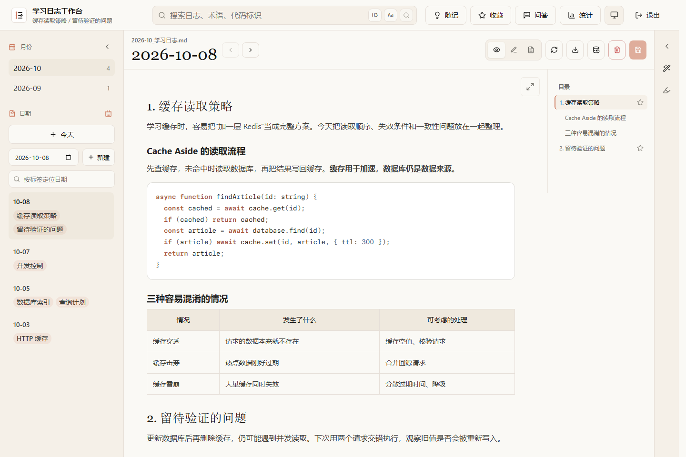
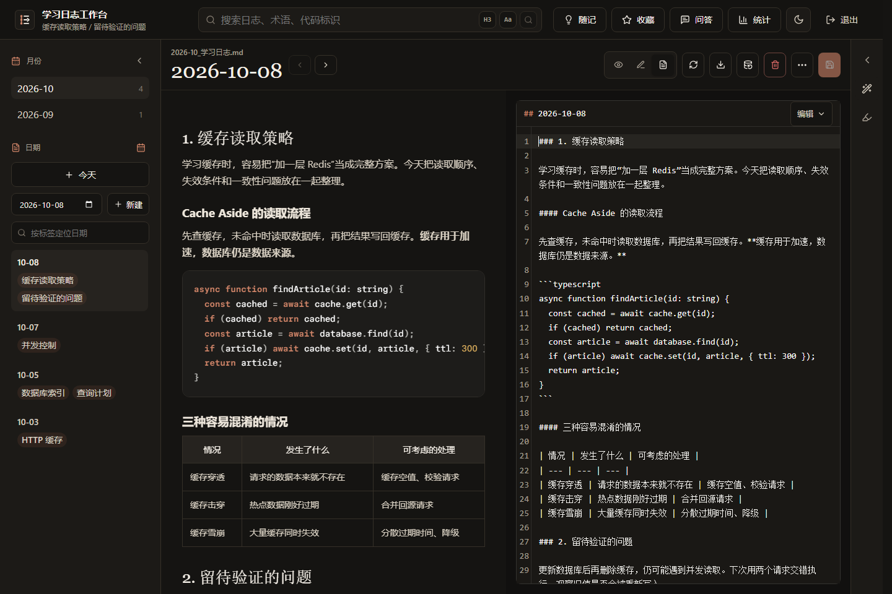

# 学习日志工作台

学习日志工作台是一款面向技术学习的 Markdown 日志工具，提供按日期记录、随记、收藏、检索问答和学习统计。可在 Windows 本地使用，也可以自行部署服务器，让浏览器、Windows 和鸿蒙客户端访问同一份记录。

配置模型服务后，可以把学习材料整理成日志草稿、提取随记，也可以围绕已有日志提问，并从回答中的引用回到原文。生成的草稿和整理建议经确认后保存。

## 能做什么

- **每日记录**：按月份和日期组织 Markdown，支持代码、公式、表格、Mermaid 和图片；提供常用格式操作、日志历史版本与单日恢复。
- **整理知识**：用随记保存零散想法，用收藏标记值得回顾的小节；导出已保存的内容与附件。
- **找回经历**：搜索日志、术语和代码；统计记录日期、数量与主题分布。
- **整理学习领域**：让 AI 根据日志小节提出分类，审核后保存，再按需要手动完善，省去逐个归类标题的重复操作。
- **AI 辅助整理**：从学习材料生成日志草稿，标注正文重点、提取随记；三套技术学习写作预设可复制为个人方案，帮助形成自己的记录写法。
- **向自己的学习记录提问**：配置聊天模型和检索服务后，用问题找回相关经历，结合日志与通用知识理解问题；回答提供来源入口，方便对照原文继续回顾。

在网页或 Windows 中等待回答时，可以切换会话或去其他模块，回答会继续生成。历史列表显示生成进度，回答完成后保存到原会话，待保存的回答和草稿也会保留。编辑历史问题时，新回答保存成功后会替换该问题及后续对话。生成失败或主动停止时，原对话和编辑稿仍会保留。

## 界面预览

网页与 Windows 桌面端共用以下编辑界面，截图使用合成学习记录。

**阅读 · 浅色模式**：从左侧日期和主题找到记录，通过右侧目录浏览当天内容。



**分屏编辑 · 深色模式**：Markdown 源码与预览并排展示，边写边查看排版。



## 选择使用方式

**在自己的电脑上离线记录，可以选择 Windows 桌面端的本地模式。** 记录、查找和备份都可离线使用。使用远程模型时需要联网。网页和鸿蒙客户端通过局域网或公网连接自己部署的服务器。

| 方式 | 适合谁 | 从哪里开始 |
| --- | --- | --- |
| Windows 桌面端本地使用 | 在这台电脑上离线记录 | [桌面端使用说明](docs/windows-desktop.md) |
| 自部署服务器 | 希望浏览器、Windows 和鸿蒙访问同一份学习记录 | [预构建镜像 + Docker Compose 部署指南](deploy/README.md) |
| 鸿蒙客户端 | 用鸿蒙手机、平板或 PC 连接已有服务器 | [鸿蒙构建、签名与连接说明](study-log-harmony/README.md) |

Windows 本地模式把记录保存在这台电脑。选择连接服务器后，客户端打开的是服务器上的记录。

工作台按单使用者设计，源码采用 [MIT 许可证](LICENSE)。

v0.2.2 提供 Windows 安装包、服务器部署文件和供自行签名的鸿蒙 HAP。各平台的更新内容见[版本说明](deploy/RELEASE-NOTES.md)。鸿蒙客户端的后续修订包见[发布记录](https://github.com/Torry2022/study-log-workbench/releases)。

### Windows：本地使用

下载 [Windows x64 安装包](https://github.com/Torry2022/study-log-workbench/releases/download/v0.2.2/study-log-desktop-0.2.2-x64-setup.exe)，可用[发布页](https://github.com/Torry2022/study-log-workbench/releases/tag/v0.2.2)提供的 SHA-256 文件核对下载。

1. 安装桌面试用包，首次打开选择“本地使用”，确认保存位置。
2. 点击“今天”，写下学习内容并保存。
3. 需要 AI 时再到“文件 → 模型设置…”配置。需要独立备份时使用“文件 → 创建完整备份…”。

使用示例仅在新建工作台时提供，介绍基本操作和推荐的 Markdown 写法。你可以直接编辑它，也可以删除后开始写自己的记录。

网页与 Windows 的随记、收藏和问答页面也提供使用引导：随记展示写法示例，收藏介绍如何标记日志小节，问答提供可修改的示例问题。

### 服务器：使用预构建镜像

在 Linux amd64 主机上安装 Docker 和 Docker Compose，然后下载[服务器部署配置包](https://github.com/Torry2022/study-log-workbench/releases/download/v0.2.2/study-log-server-0.2.2.zip)（或使用 `deploy/` 中的文件）。按[部署指南](deploy/README.md)拉取公开镜像、初始化并启动服务。

请使用同一版本配套的镜像、Compose 示例和[版本说明](deploy/RELEASE-NOTES.md)。首次部署先确认本机能够访问，再按需要配置模型、HTTPS 和其他客户端。服务器和域名由部署者准备。

## 保存与备份

日志、随记、附件和配置保存在工作台指定的目录中，日志文件按月或按年组织。日志读取范围以实例配置的目录为准。

- **日志历史版本**与原记录一起保存，用于恢复误改的某一天。Windows 可设置是否保留及保留期限。
- **完整备份**包含学习记录、附件、配置和明文密钥，适合另存到受保护的磁盘或设备。恢复时选择新目录，保留原有学习记录。
- **导出**用于取出已保存的内容；需要连同配置一起保存或搬迁工作台时，请使用完整备份。

备份、恢复和搬迁的具体操作见[备份与恢复](docs/backup-restore.md)。搬迁后，本地与服务器上的记录仍各自保存。

## 配置与开发

AI 接口、个人写作方案及只读检索配置见[AI 配置](docs/ai-configuration.md)和[部署说明](docs/deployment.md)。关键词检索可独立使用，向量和重排服务按需配置。

自行构建 Windows 桌面端可参阅[桌面构建说明](docs/windows-desktop.md#开发与验收)。

从源码运行需要 Node.js 22.13 或更新版本。以下为 Windows PowerShell 示例，在仓库根目录执行：

```powershell
npm --prefix study-log-web ci
node ops/instance.mjs init "D:\workbench-instance"
npm run build
node ops/run-web.mjs start "D:\workbench-instance" 3560
```

初始化时，指定一个新目录，或使用已有的学习记录目录。从该目录的 `.env` 文件读取 `APP_PASSWORD`，启动后访问 `http://127.0.0.1:3560/study-log`。其他系统及 Docker 源码构建见[开发部署说明](docs/deployment.md)。

源码按 `study-log-web/`、`study-log-mcp/`、`study-log-harmony/` 和 `ops/` 组织。参考[架构](docs/architecture.md)、[接口契约](docs/api-contract.md)、[设计规范](DESIGN.md)及[发布与验收流程](docs/releasing.md)。依赖声明见 [THIRD_PARTY_NOTICES.md](THIRD_PARTY_NOTICES.md)。
