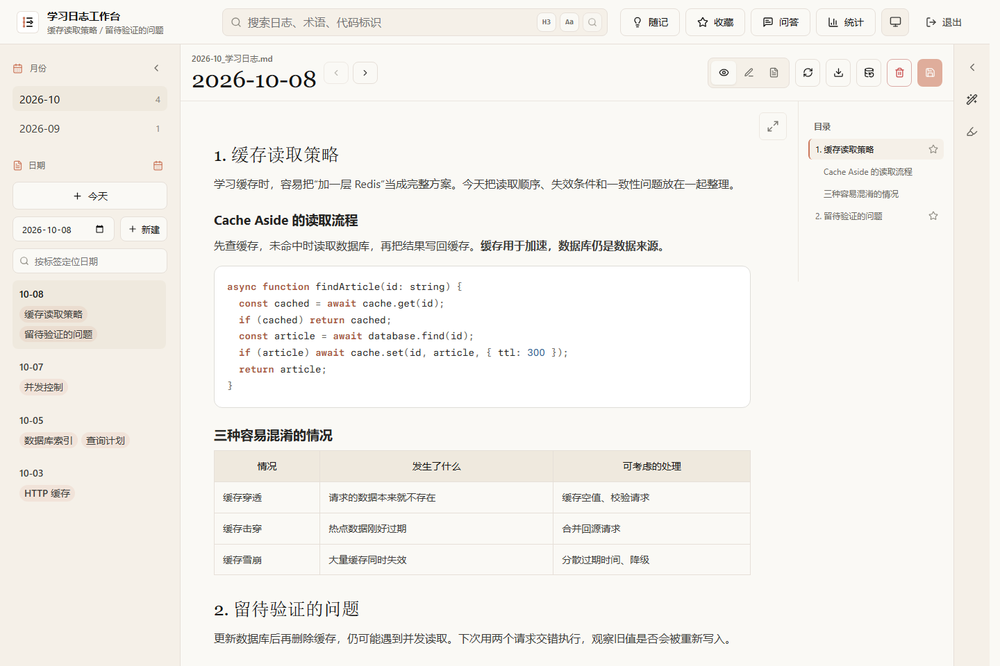
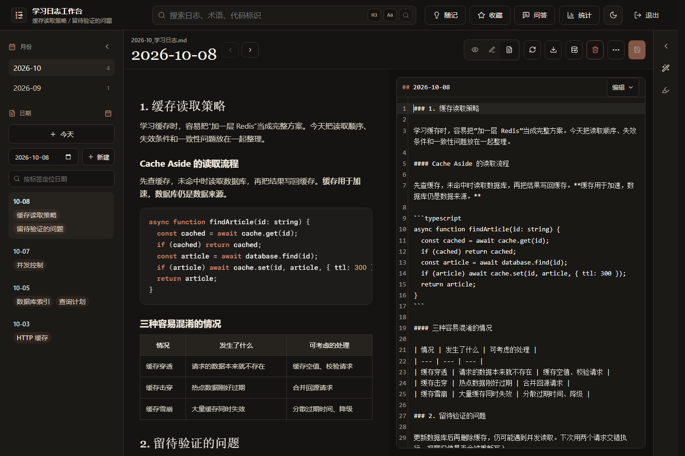

# 学习日志工作台

学习日志工作台是一款面向技术学习的 Markdown 日志工具，提供按日期记录、随记、收藏、检索问答和学习统计。可在 Windows 本地使用，也可以自行部署服务器，让浏览器、Windows 和鸿蒙客户端访问同一份记录。

配置模型服务后，可以把学习材料整理成日志草稿、提取随记，也可以围绕已有日志提问，并从回答中的引用回到原文。生成的草稿和整理建议经确认后保存。

## 能做什么

- **每日记录**：按月份和日期组织 Markdown，支持代码、公式、表格、Mermaid 和图片；提供常用格式操作、日志历史版本与单日恢复。
- **整理知识**：用随记保存零散想法，用收藏标记值得回顾的小节；导出已保存的内容与附件。
- **找回经历**：搜索日志、术语和代码；统计记录日期、数量与主题分布。
- **整理学习领域**：让 AI 根据日志小节提出分类，审核后保存，再按需要手动完善，省去逐个归类标题的重复操作。
- **AI 辅助整理**：从学习材料生成日志草稿，标注正文重点、提取随记；三套技术学习写作预设可复制为个人方案，帮助形成自己的记录写法。
- **向自己的学习记录提问**：配置聊天模型和检索服务后，用问题找回相关经历，结合日志与通用知识理解问题；回答提供来源入口，方便对照原文继续回顾。

在网页或 Windows 中等待回答时，可以切换会话或去其他模块，回答会继续生成。历史列表显示生成进度，完成后保存到原会话，未保存的回答和草稿也会保留。Windows 本地模式下，退出应用会停止本地服务。支持编辑已保存的问题：新回答保存成功后，替换该问题及后续对话；生成失败或主动停止时，原对话和编辑稿仍会保留。

## 界面预览

网页与 Windows 桌面端共用以下编辑界面，截图使用合成学习记录。

**阅读 · 浅色模式**：从左侧日期和主题找到记录，通过右侧目录浏览当天内容。



**分屏编辑 · 深色模式**：Markdown 源码与预览并排展示，边写边查看排版。



## 选择使用方式

**在自己的电脑上离线记录，可以选择 Windows 桌面端的本地模式。** 记录、查找和备份都可离线使用；AI 功能访问你配置的模型服务，使用远程模型时需要联网。网页和鸿蒙客户端需要连接服务器，服务器可部署在局域网或公网；这两种客户端目前没有独立离线模式。

| 方式 | 适合谁 | 从哪里开始 |
| --- | --- | --- |
| Windows 桌面端本地使用 | 希望离线记录，不部署服务器 | [桌面端使用说明](docs/windows-desktop.md) |
| 自部署服务器 | 希望浏览器、Windows 和鸿蒙访问同一份学习记录 | [预构建镜像 + Docker Compose 部署指南](deploy/README.md) |
| 鸿蒙客户端 | 已有可连接的服务器 | [鸿蒙构建、签名与连接说明](study-log-harmony/README.md) |

Windows 桌面端既可本地使用，也可连接服务器。本地与服务器上的记录**各自保存，彼此不自动同步**；连接同一服务器的客户端共用服务器上的学习记录。Windows 本地服务默认只供这台电脑访问。

工作台按单使用者设计，目前没有多用户账号或项目方提供的公共云服务。源码按 MIT 许可开放，当前仍处于试用阶段。

本源码版本为 0.2.0，提供 Windows 安装包、服务器部署文件和鸿蒙客户端源码。变更与实际验证范围见[发布记录](docs/release-0.2.0-2026-10-31.md)。

### Windows：本地使用

下载 [Windows x64 安装包](https://github.com/Torry2022/study-log-workbench/releases/download/v0.2.0/study-log-desktop-0.2.0-x64-setup.exe)。安装包尚未签名；版本说明和 SHA-256 校验文件可在[发布页](https://github.com/Torry2022/study-log-workbench/releases/tag/v0.2.0)查看。

1. 安装桌面试用包，首次打开选择“本地使用”，确认保存位置。
2. 点击“今天”，写下学习内容并保存。
3. 需要 AI 时再到“文件 → 模型设置…”配置。需要独立备份时使用“文件 → 创建完整备份…”。

桌面端无需另装 Node、Docker 或打开浏览器。

使用示例仅在新建工作台时提供，介绍基本操作和推荐的 Markdown 写法。你可以直接编辑它，也可以删除后开始写自己的记录。

网页与 Windows 的随记、收藏和问答页面也提供使用引导：随记展示写法示例，收藏介绍如何标记日志小节，问答提供可修改的示例问题。

### 服务器：使用预构建镜像

准备自己的 Linux amd64 主机及 Docker Compose，下载[服务器部署配置包](https://github.com/Torry2022/study-log-workbench/releases/download/v0.2.0/study-log-server-0.2.0.zip)（或使用 `deploy/` 中的文件），按[部署指南](deploy/README.md)完成初始化和启动。使用公开 ACR 镜像无需阿里云账号，也无需在服务器安装 Node 或构建源码。

请使用同一版本配套的镜像、Compose 示例和[版本说明](deploy/RELEASE-NOTES.md)。首次部署先确认本机能够访问，再按需要配置模型、HTTPS 和其他客户端。服务器和域名由部署者准备。

## 保存与备份

日志、随记、附件和配置保存在工作台指定的目录中，日志文件按月或按年组织。日志读取范围以实例配置的目录为准。

- **日志历史版本**用于恢复误改的某一天，默认保留；Windows 可设置开关和保留期限。它与原记录保存在同一文件夹，不能代替独立备份。
- **完整备份**由你主动创建，包含学习记录、附件及配置，建议另存到其他磁盘或设备。恢复时使用新目录，保留原有学习记录。备份归档包含密钥且未加密，请妥善保存。
- **导出**用于取出已保存的内容；需要连同配置一起保存或搬迁工作台时，请使用完整备份。

备份、恢复和搬迁的具体操作见[备份与恢复](docs/backup-restore.md)。搬迁后，本地与服务器上的记录仍各自保存。

## 当前限制

- Windows 安装、同版本覆盖安装、保留学习记录及归档恢复已有维护者测试；安装包未签名，跨版本数据迁移未完成验证。
- 服务器镜像当前支持 Linux amd64。部署版本及验证范围以[版本说明](deploy/RELEASE-NOTES.md)为准。
- 鸿蒙支持手机、平板和 PC，当前以源码构建和侧载为主。使用者需自行配置签名；维护者调试包不适用于所有设备。独立签名及异网络 HTTPS 连接仍待验。
- Wiki、分享、跨设备接续和鸿蒙独立离线存储暂未提供。

以上列出的是维护者测试和自动化验收结果。想了解当前进度和待完成事项，可以查看[进度总览](docs/current-status.md)；具体测试记录见[实施状态](docs/implementation-status.md)、[桌面端说明](docs/windows-desktop.md)、[服务器验收](docs/server-deployment-acceptance.md)和[鸿蒙迁移记录](docs/harmony-migration.md)。开始使用时，按所选平台的使用说明操作即可。

## 配置与开发

AI 接口、个人写作方案及只读检索配置见[AI 配置](docs/ai-configuration.md)和[部署说明](docs/deployment.md)。关键词检索可独立使用，向量和重排服务按需配置。

希望自行构建 Windows 桌面端，可参阅[桌面构建说明](docs/windows-desktop.md#开发与验收)。此前的[浏览器本地包](docs/windows-portable.md)仍保留，日常使用建议选择桌面安装包。

从源码运行需要 Node.js 22.13 或更新版本。以下为 Windows PowerShell 示例，在仓库根目录执行：

```powershell
npm --prefix study-log-web ci
node ops/instance.mjs init "D:\workbench-instance"
npm run build
node ops/run-web.mjs start "D:\workbench-instance" 3560
```

初始化时，选择尚不存在的保存目录，或指定已有学习记录的有效目录。密码保存在该位置的 `.env` 文件中，对应 `APP_PASSWORD`，初始化命令不在终端显示密码。启动后访问 `http://127.0.0.1:3560/study-log`。请勿将学习记录、环境文件、备份归档或签名材料提交到 Git。其他系统及 Docker 源码构建见[开发部署说明](docs/deployment.md)。

源码按 `study-log-web/`、`study-log-mcp/`、`study-log-harmony/` 和 `ops/` 组织。参考[架构](docs/architecture.md)、[接口契约](docs/api-contract.md)、[配套发布流程](docs/releasing.md)和[设计规范](DESIGN.md)；许可证见 [LICENSE](LICENSE)，依赖声明见 [THIRD_PARTY_NOTICES.md](THIRD_PARTY_NOTICES.md)。

### 自动检查与手动验收

[CI](.github/workflows/ci.yml) 在 main 推送和 PR 时按改动路径执行 Web 类型检查、替身单测及生产构建、MCP 测试、鸿蒙 Node 协议测试，以及维护工具和 Windows 可跨平台逻辑测试。使用 Node 22.23.3 与锁文件安装依赖；鸿蒙协议测试不代表 SDK 构建或真机验收，Linux 作业会保留既有 Windows ACL 测试跳过标记。

问答滚动与编辑的双浏览器检查、Docker 部署及归档验收、Windows 打包启动检查，分别在 [Manual acceptance](.github/workflows/acceptance.yml) 中按需运行。工作流仅使用托管 runner、合成资料和模型替身，不使用生产配置或签名，也不会发布、部署或安装到设备。失败日志与截图保留 3 天。
